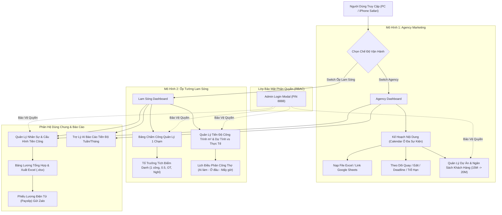

# 🏢 HỆ THỐNG QUẢN LÝ CHẤM CÔNG, TIẾN ĐỘ DỰ ÁN & TÍNH LƯƠNG DOANH NGHIỆP KÉP
### (Agency Sáng Tạo Nội Dung & Đơn Vị Thi Công Ốp Tường Lam Sóng Nano)

> **Nền tảng chuyển đổi số 2-trong-1**: Tối ưu hóa toàn bộ quy trình vận hành từ lập Kế hoạch sản xuất nội dung đa sự kiện (Quay phim, Dựng video, Lịch đăng), Điểm danh công thợ 1 chạm tại công trình, Giám sát tiến độ số ngày dự tính vs thực tế $m^2$, Tự động tính lương & Xuất file Excel chuẩn, đến Báo cáo tiến độ tự động bằng AI và Phân quyền Quản trị viên (Admin).

---

## 📑 MỤC LỤC
1. [Tổng Quan Dự Án & Tầm Nhìn](#1-tổng-quan-dự-án--tầm-nhìn)
2. [Kiến Trúc Kỹ Thuật (Tech Stack)](#2-kiến-trúc-kỹ-thuật-tech-stack)
3. [Sơ Đồ Luồng Hoạt Động & Kiến Trúc Dữ Liệu](#3-sơ-đồ-luồng-hoạt-động--kiến-trúc-dữ-liệu)
4. [Các Phân Hệ Chức Năng Chính](#4-các-phân-hệ-chức-năng-chính)
   - [Phân hệ 1: Kế Hoạch Nội Dung Agency & Lịch Đa Sự Kiện](#41-phân-hệ-agency-kế-hoạch-nội-dung--lịch-đa-sự-kiện)
   - [Phân hệ 2: Quản Lý Thi Công Ốp Tường Lam Sóng & Lịch Thợ](#42-phân-hệ-ốp-tường-lam-sóng-tiến-độ-công-trình--lịch-thợ)
   - [Phân hệ 3: Bảng Chấm Công Quản Lý 1 Chạm & Nhật Ký](#43-phân-hệ-chấm-công-quản-lý-1-chạm--nhật-ký)
   - [Phân hệ 4: Cấu Hình Tiền Công & Tính Lương Tự Động](#44-phân-hệ-tiền-công-tính-lương-tự-động--xuất-excel)
   - [Phân hệ 5: Trợ Lý AI Báo Cáo Tiến Độ Tuần/Tháng](#45-trợ-lý-ai-báo-cáo-tiến-độ-tuần--tháng)
   - [Phân hệ 6: Hệ Thống Phân Quyền & Bảo Mật Admin (PIN 8888)](#46-hệ-thống-phân-quyền--bảo-mật-admin)
5. [Cấu Trúc Thư Mục & Giải Thích Mã Nguồn](#5-cấu-trúc-thư-mục--giải-thích-mã-nguồn)
6. [Hướng Dẫn Cài Đặt & Chạy Môi Trường Local](#6-hướng-dẫn-cài-đặt--chạy-môi-trường-local)
7. [Hướng Dẫn Dành Cho Lập Trình Viên Đọc & Sửa Code](#7-hướng-dẫn-dành-cho-lập-trình-viên-đọc--sửa-code)
   - [Cách thêm trường thông tin mới](#71-cách-thêm-trường-thông-tin-mới)
   - [Cách thêm dự án / khách hàng mẫu](#72-cách-thêm-dự-án--khách-hàng-mẫu)
   - [Cách tùy biến công thức tính lương](#73-cách-tùy-biến-công-thức-tính-lương)
   - [Cách kết nối cơ sở dữ liệu Supabase Cloud](#74-cách-kết-nối-cơ-sở-dữ-liệu-supabase-cloud)
8. [Hướng Dẫn Đẩy Dự Án Lên GitHub & Triển Khai Cloud](#8-hướng-dẫn-đẩy-dự-án-lên-github--triển-khai-cloud)
9. [Sử Dụng Trên Điện Thoại Di Động (iPhone / Android)](#9-sử-dụng-trên-điện-thoại-di-động-iphone--android)

---

## 1. TỔNG QUAN DỰ ÁN & TẦM NHÌN

Dự án ra đời nhằm giải quyết triệt để bài toán quản lý song song hai mô hình kinh doanh có đặc thù vận hành hoàn toàn trái ngược nhưng cùng chung một chủ sở hữu:

1. **Công Ty Truyền Thông / Agency Marketing**:
   - Nhân sự làm việc tại văn phòng hoặc Remote (WFH).
   - Lương tính theo tháng cố định + phụ cấp ăn trưa.
   - Quản lý theo kế hoạch xuất bản nội dung (Content Calendar): Một ngày có thể có nhiều việc cùng lúc (vừa đi quay hiện trường, vừa dựng video, vừa duyệt bài đăng).
   - Quản lý nhiều đối tác / khách hàng (Ví dụ: Dự án nhà hàng *Feel Chicken* từ gói 15.000.000đ/tháng nâng lên 20.000.000đ/tháng khi mở rộng số lượng video).
   - Cảnh báo trễ hạn (Deadline) để đảm bảo cam kết KPI với khách hàng.

2. **Công Ty Thi Công Ốp Tường Nhựa Lam Sóng Nano**:
   - Đội ngũ thợ thi công cơ động tại nhiều công trình phân tán (Biệt thự, nhà phố, chung cư, showroom).
   - Lương tính theo **Công Nhật** (350.000đ - 550.000đ/ngày) + **Tăng ca tối OT** + **Phụ cấp xăng xe**.
   - Giám sát tiến độ thi công dựa trên: **Khối lượng mét vuông ($m^2$) thực tế** và **Số ngày dự tính ban đầu vs Số ngày thực tế làm việc**.
   - Điều phối lịch thợ chi tiết: *Ai làm - Ở đâu - Mấy giờ - Hạng mục gì (khung xương, ốp tấm, nẹp chỉ)*.

3. **Tính năng độc nhất**: Chuyển đổi 1 chạm tức thì giữa 2 công ty ngay trên Header mà không cần đăng nhập lại, dữ liệu được phân lập an toàn và đồng bộ.

---

## 2. KIẾN TRÚC KỸ THUẬT (TECH STACK)

| Thành Phần | Công Nghệ Sử Dụng | Mục Đích / Ưu Điểm |
| :--- | :--- | :--- |
| **Core Framework** | **React 19** + **TypeScript** | Giao diện phản hồi cực nhanh, kiểu dữ liệu tĩnh an toàn, không sợ lỗi runtime. |
| **Build Tool** | **Vite 8** | Khởi động server nội bộ trong 300ms, hỗ trợ Hot Module Reloading (HMR) tức thì. |
| **Styling** | **Tailwind CSS 3** | Thiết kế giao diện hiện đại, tối ưu 100% hiển thị trên iPhone Safari và PC Desktop. |
| **Icon System** | **Lucide React** | Bộ icon SVG nhẹ, sắc nét và trực quan cho xây dựng & marketing. |
| **Excel Engine** | **SheetJS (xlsx)** | Đọc file Excel (.xlsx, .xls), import Google Sheets, xuất bảng lương chi tiết. |
| **Hiệu Ứng** | **Canvas Confetti** | Bắn pháo hoa ăn mừng khi lưu công thành công hoặc dự án bàn giao vượt tiến độ. |
| **Database & Offline** | **Supabase (PostgreSQL)** + **LocalStorage Engine** | Chạy Offline mượt mà không cần mạng Internet; tự động đồng bộ dữ liệu lên Đám mây khi có Wi-Fi/4G. |
| **Bảo Mật & Phân Quyền**| **Custom RBAC + PIN Token** | Phân quyền Admin mã PIN `8888`, khóa toàn bộ quyền sửa công/tiền lương với người xem. |

---

## 3. SƠ ĐỒ LUỒNG HOẠT ĐỘNG & KIẾN TRÚC DỮ LIỆU



---

## 4. CÁC PHÂN HỆ CHỨC NĂNG CHÍNH

### 4.1. Phân Hệ Agency: Kế Hoạch Nội Dung & Lịch Đa Sự Kiện
- **Giao diện Lịch Kế Hoạch (Grid & List View)**: Hiển thị 31 ô ngày trong tháng tương tự phong cách lịch sáng tạo của các Agency hàng đầu.
- **Hỗ trợ Đa Sự Kiện trong cùng 1 ngày**: Thứ Hai vừa có lịch đi quay video hiện trường, vừa có lịch dựng clip ngắn. Mỗi sự kiện có thẻ riêng biệt với giờ giấc và người phụ trách rõ ràng.
- **Chi tiết từng thẻ kế hoạch**:
  - Người làm Content (Ý tưởng kịch bản).
  - Người đi quay (Cameraman).
  - Người edit video (Editor).
  - Hạn chót duyệt (Deadline) kèm cảnh báo chữ **`Trễ!`** màu đỏ nhấp nháy nếu quá hạn mà chưa bàn giao.
  - Nút chuyển trạng thái 1 chạm: **`Chưa xong`** $\leftrightarrow$ **`✓ Đã xong`**.
- **Nạp Dữ Liệu Tự Động (Import)**:
  - Nạp trực tiếp file **Excel (.xlsx, .xls)**.
  - Nạp qua **Link Google Sheets công khai** (tự động phân tích cột Ngày, Tiêu đề, Format, Kịch bản).
- **Quản lý đa dự án / khách hàng**: Hỗ trợ chuyển đổi giữa nhiều đối tác (như nhà hàng *Feel Chicken*). Cho phép Admin sửa ngân sách (từ 15 triệu lên 20 triệu/tháng), tăng KPI video và gói dịch vụ.

### 4.2. Phân Hệ Ốp Tường Lam Sóng: Tiến Độ Công Trình & Lịch Thợ
- **So sánh Ngày Dự Tính vs Thực Tế**:
  - Mỗi công trình có thông tin: Số ngày dự tính ban đầu (ví dụ: 5 ngày) và Số ngày thực tế đội thợ thi công.
  - Tự động đánh giá hiệu quả: *Về đích sớm (vượt tiến độ)*, *Đúng kế hoạch* hoặc *Cảnh báo làm quá ngày dự tính*.
- **Giám sát khối lượng $m^2$**: Theo dõi tổng diện tích cần ốp, diện tích đã ốp xong và tỷ lệ hoàn thành (%).
- **Lịch điều thợ chi tiết hôm nay**:
  - Hiển thị danh sách: *Hôm nay ai làm? Ở công trình nào? Khung giờ mấy giờ đến mấy giờ? Hạng mục cụ thể là gì?*

### 4.3. Phân Hệ Chấm Công Quản Lý 1 Chạm & Nhật Ký
- **Thiết kế tối ưu cho Quản lý / Tổ trưởng thợ**: Không bắt từng người công nhân phải mở điện thoại tự thao tác phức tạp.
- **1 màn hình duy nhất cho cả đội**:
  - Danh sách toàn bộ thợ hiển thị trên một trang.
  - Nút bấm nhanh: **`1.0 Công`**, **`0.5 Công`**, **`1.5 Công`**, **`Nghỉ`** hoặc gõ số lẻ tùy ý.
  - Chọn nhanh giờ tăng ca tối (**OT**): `0h`, `1h`, `1.5h`, `2h`, `3h`, `4h`.
  - Dropdown chọn công trình đang làm hoặc nhập địa điểm ngoài xưởng.
  - Nút **`Chấm tất cả 1.0 công`** và **`Áp dụng chung 1 công trình`** giúp điểm danh cả đội 10 người trong chưa đầy 10 giây.
- **Nhật ký & Lịch sử chấm công**: Xem lại lịch sử công của các ngày trước trong tháng, có bộ lọc theo ngày và quyền xóa/sửa cho Admin.

### 4.4. Phân Hệ Tiền Công, Tính Lương Tự Động & Xuất Excel
- **Cấu hình tiền công linh hoạt**:
  - Thợ ốp tường: Tính theo **Công nhật** (ví dụ: 450.000đ/công) + giờ OT + phụ cấp công trình xa.
  - Nhân viên Agency: Tính theo **Lương cứng tháng** (ví dụ: 12.000.000đ/tháng chia 26 ngày chuẩn) + phụ cấp ăn trưa.
- **Bảng tổng hợp tiền lương tháng**: Tự động tính toán tổng công, tổng giờ tăng ca, tổng phụ cấp và số tiền thực nhận.
- **Xuất file Excel (.xlsx) chuẩn**: 1 click chuột tải về file Excel đầy đủ cột STT, Tên, Số công, Tiền công, Giờ OT, Phụ cấp, Thực nhận để nộp cho Giám đốc/Kế toán.
- **Phiếu lương điện tử (Payslip)**: Xem phiếu chi tiết từng khoản lương của từng thợ để chụp màn hình gửi Zalo minh bạch.

### 4.5. Trợ Lý AI Báo Cáo Tiến Độ Tuần & Tháng
- Nút **`🤖 AI Báo Cáo`** trên thanh Header.
- Tự động phân tích dữ liệu thực tế:
  - Tỷ lệ hoàn thành kế hoạch video của Agency, nhân viên nào có bài trễ hạn nhiều nhất.
  - Tiến độ $m^2$ các công trình ốp tường, công trình nào đang chạy quá số ngày dự tính, tổng số công thợ đã bỏ ra.
  - Xuất báo cáo chuyên nghiệp có thể copy gửi Zalo / Email cho Giám đốc.

### 4.6. Hệ Thống Phân Quyền & Bảo Mật Admin
- **Mã PIN mặc định**: `8888` (Hỗ trợ đổi mã PIN mới ngay trên popup).
- **Quyền hạn của Admin (Quản trị viên)**:
  - Thêm, sửa, xóa dự án/khách hàng Agency; sửa đổi ngân sách hợp đồng (15M $\rightarrow$ 20M).
  - Thêm, sửa, xóa công trình ốp lam sóng; sửa số ngày dự tính/thực tế, diện tích $m^2$.
  - Sửa đổi bảng công, điểm danh cho thợ, lưu bảng công và xóa nhật ký lịch sử.
  - Thay đổi đơn giá công nhật, lương cơ bản, giá giờ OT, phụ cấp và xóa nhân sự.
- **Quyền của người dùng thường**: Ở chế độ chỉ xem (Read-only); khi bấm vào bất kỳ chức năng quản trị nào, hệ thống sẽ tự động yêu cầu nhập mã PIN Admin.

---

## 5. CẤU TRÚC THƯ MỤC & GIẢI THÍCH MÃ NGUỒN

```text
├── index.html                   # File HTML chính, cấu hình viewport tối ưu cho iPhone Safari
├── package.json                 # Khai báo thư viện: React 19, Lucide, SheetJS, Supabase
├── vite.config.ts               # Cấu hình Vite dev server và build
├── tailwind.config.js           # Cấu hình màu sắc, phông chữ, responsive
├── supabase_schema.sql          # Mã nguồn SQL tạo cấu trúc bảng trên Supabase Cloud
│
├── src/
│   ├── main.tsx                 # Điểm khởi động ứng dụng React
│   ├── App.tsx                  # Component gốc: Quản lý State toàn cục, chuyển đổi tab & phân quyền
│   ├── index.css                # CSS toàn cục, định nghĩa font chữ và thanh cuộn đẹp
│   │
│   ├── types/
│   │   └── index.ts             # Toàn bộ TypeScript Interfaces (Employee, Site, Attendance, Task, Project...)
│   │
│   ├── services/
│   │   ├── auth.ts              # Xử lý đăng nhập Admin, lưu phiên vào localStorage, đổi PIN
│   │   ├── db.ts                # Tầng truy xuất dữ liệu: LocalStorage CRUD + định dạng tiền tệ VNĐ/ngày
│   │   ├── calendarParser.ts    # Bộ máy phân tích file Excel và link Google Sheets
│   │   └── aiReporter.ts        # Thuật toán tổng hợp dữ liệu & sinh báo cáo tiến độ tuần/tháng
│   │
│   ├── data/
│   │   ├── mockData.ts          # Dữ liệu ban đầu (nhân sự mẫu, công trình ốp tường mẫu)
│   │   └── feelChickenCalendar.ts # Kế hoạch nội dung mẫu 31 ngày của khách hàng Feel Chicken
│   │
│   └── components/
│       ├── Header.tsx           # Thanh điều hướng trên cùng, đổi công ty, badge Admin
│       ├── AdminLoginModal.tsx  # Cửa sổ nhập mã PIN Admin & đổi mật khẩu
│       ├── AgencyContentCalendar.tsx # Lịch kế hoạch Agency, ô đa sự kiện, nạp Excel, sửa ngân sách
│       ├── AttendanceManager.tsx    # Bảng chấm công 1 chạm cho quản lý ốp lam sóng
│       ├── ConstructionScheduleTracker.tsx # Quản lý công trình, so sánh ngày dự tính vs thực tế
│       ├── StaffAndWageManager.tsx  # Quản lý nhân viên, cấu hình đơn giá công nhật & OT
│       ├── PayrollManager.tsx       # Bảng lương tự động, phiếu lương Zalo, xuất file Excel
│       ├── WorkProgressManager.tsx   # Quản lý tiến độ $m^2$, nhật ký ảnh hiện trường
│       ├── AIReportingModal.tsx     # Cửa sổ hiển thị báo cáo AI hàng tuần/tháng
│       ├── SupabaseModal.tsx        # Cửa sổ hướng dẫn kết nối Cloud Database
│       └── IphoneGuideModal.tsx     # Hướng dẫn tạo icon App trên màn hình chính iPhone
```

---

## 6. HƯỚNG DẪN CÀI ĐẶT & CHẠY MÔI TRƯỜNG LOCAL

### Yêu Cầu Tiên Quyết
- Đã cài đặt **Node.js** (Khuyến nghị phiên bản 18 trở lên hoặc 20 LTS).
- Trình quản lý gói `npm` (đi kèm sẵn với Node.js).

### Các Bước Cài Đặt
1. **Mở Terminal / PowerShell** tại thư mục dự án:
   ```bash
   cd "e:\antigravyti\chấm công và tiến độ công việc"
   ```

2. **Cài đặt các gói phụ thuộc (Dependencies)**:
   ```bash
   npm install
   ```

3. **Khởi chạy máy chủ phát triển nội bộ**:
   ```bash
   npm run dev
   ```
   Ứng dụng sẽ hiển thị các đường link truy cập:
   - **Trên máy tính**: `http://localhost:5173`
   - **Trên điện thoại cùng mạng Wi-Fi**: `http://192.168.1.xxx:5173`

4. **Kiểm tra biên dịch sản phẩm (Build Check)**:
   ```bash
   npm run build
   ```
   Lệnh này thực hiện kiểm tra kiểu TypeScript (`tsc -b`) và nén code bằng Vite (`vite build`).

---

## 7. HƯỚNG DẪN DÀNH CHO LẬP TRÌNH VIÊN ĐỌC & SỬA CODE

Nếu bạn là một lập trình viên muốn mở rộng hoặc chỉnh sửa phần mềm này, hãy tham khảo các hướng dẫn cụ thể dưới đây:

### 7.1. Cách Thêm Trường Thông Tin Mới
Ví dụ: Bạn muốn thêm trường **"Số điện thoại Zalo của thợ"** hoặc **"Độ dày của tấm lam sóng"**:

1. **Bước 1**: Mở file [`src/types/index.ts`](file:///src/types/index.ts):
   Thêm thuộc tính vào interface tương ứng:
   ```typescript
   export interface ConstructionSite {
     // ... các trường cũ
     panelThickness?: string; // Ví dụ: '9mm', '12mm'
   }
   ```
2. **Bước 2**: Mở component giao diện (ví dụ: [`src/components/ConstructionScheduleTracker.tsx`](file:///src/components/ConstructionScheduleTracker.tsx)):
   Thêm ô nhập liệu `<input>` trong modal tạo hoặc chỉnh sửa:
   ```tsx
   <input
     type="text"
     value={editingProject.panelThickness || ''}
     onChange={(e) => setEditingProject({ ...editingProject, panelThickness: e.target.value })}
     placeholder="Độ dày tấm: 9mm..."
   />
   ```
3. Dữ liệu sẽ tự động được lưu và đồng bộ mà không cần phải viết thêm backend phức tạp!

### 7.2. Cách Thêm Dự Án / Khách Hàng Mẫu
- Dữ liệu khách hàng Agency mẫu được lưu tại [`src/data/mockData.ts`](file:///src/data/mockData.ts) trong mảng `initialAgencyProjects`.
- Kế hoạch 31 ngày mẫu được định nghĩa tại [`src/data/feelChickenCalendar.ts`](file:///src/data/feelChickenCalendar.ts). Bạn có thể sao chép cấu trúc này để tạo kế hoạch mẫu cho các khách hàng mới.

### 7.3. Cách Tùy Biến Công Thức Tính Lương
Mở file [`src/components/PayrollManager.tsx`](file:///src/components/PayrollManager.tsx):
- Tìm hàm tính toán `payrollList`:
  ```typescript
  if (emp.wageType === 'daily') {
    // Công thức công nhật: Số công * Đơn giá/ngày
    basePay = totalWorkUnits * emp.baseRate;
  } else {
    // Công thức lương tháng: (Lương cứng / 26 ngày chuẩn) * Số công thực tế
    basePay = Math.round((emp.baseRate / 26) * totalWorkUnits);
  }
  const otPay = totalOtHours * emp.otRate; // Tiền tăng ca
  const netSalary = basePay + otPay + emp.allowance + bonus - deduction; // Lương thực nhận
  ```
- Bạn có thể chỉnh sửa số ngày công chuẩn (26 ngày thành 24 ngày), hoặc thêm công thức thưởng chuyên cần tùy ý.

### 7.4. Cách Kết Nối Cơ Sở Dữ Liệu Supabase Cloud
Khi muốn lưu trữ dữ liệu vĩnh viễn trên đám mây để nhiều người cùng truy cập từ xa:
1. Đăng ký tài khoản miễn phí tại [https://supabase.com](https://supabase.com).
2. Tạo New Project $\rightarrow$ Vào **SQL Editor** $\rightarrow$ Dán toàn bộ nội dung file [`supabase_schema.sql`](file:///supabase_schema.sql) và bấm **Run**.
3. Tạo file `.env` tại thư mục gốc của dự án với nội dung:
   ```env
   VITE_SUPABASE_URL=https://your-project-id.supabase.co
   VITE_SUPABASE_ANON_KEY=your-anon-public-key
   ```
4. Khi khởi chạy lại ứng dụng, hệ thống sẽ tự động chuyển sang đồng bộ trực tiếp với Supabase PostgreSQL!

---

## 8. HƯỚNG DẪN ĐẨY DỰ ÁN LÊN GITHUB & TRIỂN KHAI CLOUD

### 8.1. Các Lệnh Đẩy Mã Nguồn Lên GitHub
Chạy lần lượt các câu lệnh sau trong terminal của bạn:

```bash
# 1. Khởi tạo kho git nội bộ
git init

# 2. Thêm toàn bộ mã nguồn vào staging
git add .

# 3. Tạo commit đầu tiên
git commit -m "feat: he thong quan ly cham cong va tien do 2 cong ty (Agency & Op Lam Song)"

# 4. Đổi tên nhánh chính thành main
git branch -M main

# 5. Gắn địa chỉ kho lưu trữ GitHub của bạn (thay đường dẫn bằng repo của bạn)
git remote add origin https://github.com/your-username/quan-ly-cham-cong-va-tien-do-2cty.git

# 6. Đẩy toàn bộ mã nguồn lên GitHub
git push -u origin main
```

### 8.2. Triển Khai Miễn Phí Lên Vercel (Lấy Link HTTPS Chạy 24/7)
1. Đăng nhập vào [https://vercel.com](https://vercel.com) bằng tài khoản GitHub.
2. Bấm **Add New... ➔ Project**, chọn kho code `quan-ly-cham-cong-va-tien-do-2cty` bạn vừa đẩy lên.
3. Trong mục **Build and Output Settings**, giữ nguyên mặc định (Framework: *Vite*).
4. Bấm nút **Deploy**.
5. Sau 1 phút, Vercel sẽ cấp đường link trực tuyến HTTPS (ví dụ: `https://ten-du-an.vercel.app`).
6. Bạn chỉ cần gửi link này cho nhân viên, thợ thi công và đối tác là mọi người có thể sử dụng ở bất kỳ đâu qua mạng 4G/5G!

---

## 9. SỬ DỤNG TRÊN ĐIỆN THOẠI DI ĐỘNG (IPHONE / ANDROID)

Phần mềm được thiết kế theo chuẩn **Progressive Web App (PWA)**, cho phép cài đặt trực tiếp vào màn hình chính của điện thoại giống như ứng dụng tải từ App Store / Google Play mà không tốn dung lượng bộ nhớ:

### Trên iPhone (Trình duyệt Safari):
1. Mở đường link của phần mềm trong trình duyệt **Safari**.
2. Ở thanh công cụ dưới đáy màn hình, bấm vào biểu tượng **Chia sẻ** (ô vuông có mũi tên chỉ lên $\uparrow$).
3. Cuộn xuống và chọn dòng **"Thêm vào Màn hình chính"** (*Add to Home Screen*).
4. Đặt tên hiển thị (ví dụ: *Chấm Công & Tiến Độ*) và bấm **Thêm** (*Add*).
5. Một biểu tượng ứng dụng độc lập sẽ xuất hiện trên màn hình điện thoại, bấm vào sẽ chạy toàn màn hình, mượt mà và không có thanh địa chỉ web.

### Trên Android (Trình duyệt Chrome):
1. Mở đường link trên Google Chrome.
2. Bấm vào biểu tượng **3 dấu chấm** ở góc trên bên phải.
3. Chọn **"Cài đặt ứng dụng"** (*Install app*) hoặc **"Thêm vào màn hình chính"**.

---

## 🛡️ THÔNG TIN BẢN QUYỀN & GIẤY PHÉP
- Phần mềm phát triển bởi Đội ngũ Lập trình Antigravity theo đơn đặt hàng giải pháp chuyển đổi số doanh nghiệp kép.
- Mã nguồn mở phân phối theo giấy phép MIT License - tự do sử dụng, chỉnh sửa và triển khai thương mại.

---
*Cập nhật lần cuối: Tháng 11/2026. Mọi thắc mắc hoặc yêu cầu bổ sung tính năng, vui lòng tạo Issue trên GitHub hoặc liên hệ người quản trị dự án.*
